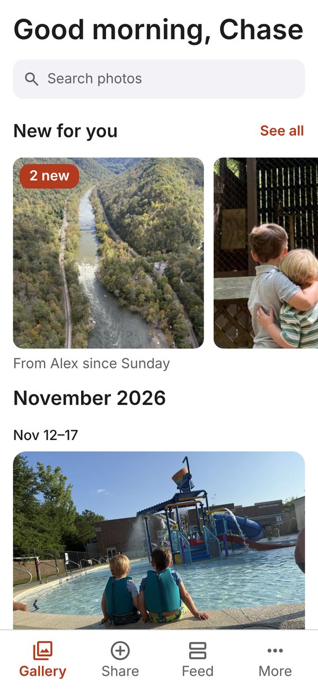
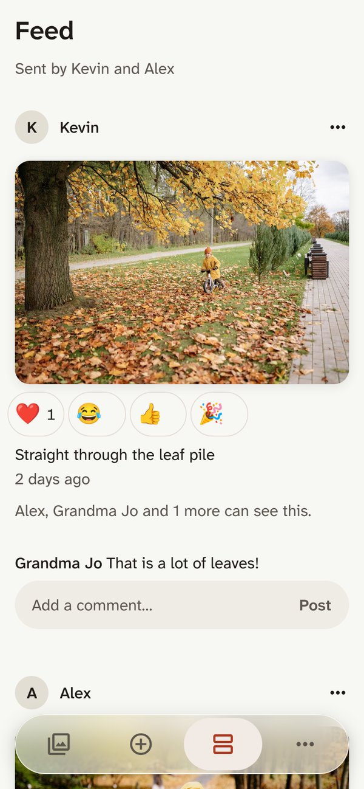
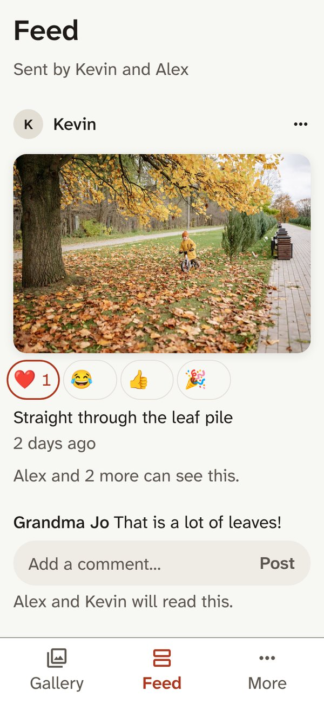

# Hearth (working name)

[](https://github.com/holroydchase-afk/hearth/actions/workflows/ci.yml)

**A private photo app for split families and for grandparents who stay off social media.** Every photo goes to an audience you pick, by name. Photos are encrypted on the phone and stored in the US, but today Hearth's server holds the photo keys and no outside party has reviewed the security. There are no ads, no trackers and no AI training.

Built by Chase Holroyd, a product manager, as a working proof of concept: one person, a $20/month AI plan, and a team of Claude agents, test-first from day one.

<p>
  
  
  
</p>

<sub>Screens from the public demo, taken Nov 24, 2026. The family is made up; the demo shows free stock photos from Pexels, with all photo data removed.<br>Sample photos: Pexels (Elly Fairytale, Yan Krukov)</sub>

**Try it, no sign-in:** [chaseholroyd.com/hearth](https://chaseholroyd.com/hearth/). It's a made-up family kept only in your browser. On a phone it's the app itself; on a laptop a short guide sits beside it. Open **Details** in the Demo bar and pick **See it as Grandma Jo** to see that each photo reaches only the people it was shared with.

## Status

Hearth is a working proof of concept, built in the open.

| | |
|---|---|
| Works today | Sign in with a code, post photos to a chosen group, see, react and comment, on iPhone and the web. Every suite that runs in CI passes, and the public demo is checked before and after each publish |
| Private beta | Coming soon, after the current polish work. No date yet |
| Built, switched off | Text message sign-in, video, and starting a family from the app |
| Known limits | Speed on a phone hasn't been measured ([performance](docs/eng/PERFORMANCE.md)). No outside security review ([threat model](docs/architecture/04-threat-model.md)). Hearth's server holds the photo keys ([encryption and keys](docs/architecture/03-encryption-and-keys.md)) |

License: AGPL-3.0 ([LICENSE](LICENSE)). The repo is public. [Contributing](CONTRIBUTING.md) · [Security](SECURITY.md) · [Code of Conduct](CODE_OF_CONDUCT.md).

## Start here

| To see | Read |
|---|---|
| How it works and what it protects | [Architecture](docs/architecture/) (system overview, data flow, encryption and keys, threat model) |
| Why each call was made | [Decision log](docs/product/DECISION-LOG.md): every decision, what it beat, and why |
| How it's tested | [Testing](docs/eng/TESTING.md), plus `bash scripts/test-totals.sh` for the real totals |
| What changed so far | [Changelog](CHANGELOG.md): what a user or visitor can see, in plain words |
| What's in scope | [Beta spec](docs/product/BETA-SPEC.md): the acceptance criteria each feature is tested against |
| What went wrong and what changed | [Lessons](docs/eng/LESSONS.md): six post mortems, each with the rule or guard it added |

## The problem

Families with divorces, remarriages and step-relatives don't fit one group chat. A parent wants Grandma on one side to see the school photos without the other household's relatives seeing everything too. Many grandparents won't join Facebook, and they lose photos in long text threads. The tools that exist were designed for one tidy family, or they make money from attention and data.

## What Hearth does

- **Pick the audience by name, every time.** Groups are plain named lists ("Grandparents, Dad's side"). A photo you can't see behaves as if it doesn't exist.
- **Built for the least tech-savvy relative.** Text is 17 pt or larger, tap targets are 48 pt, and no action needs a gesture. Easy view, on by default for grandparents, puts a word under every icon and makes text bigger; with it off, the tab icons keep their spoken names. Sign-in uses a 6-digit email code, so there's no password.
- **Private by construction.** Location and camera data are stripped on the phone and checked before upload. Photos are encrypted on the phone (AES-256-GCM); Hearth's server holds the photo keys today. Group chat is built on MLS (RFC 9420) end-to-end encryption; it hasn't been tested by hand on two phones or audited, and key verification isn't built. Access rules live in the database, with row-level security.
- **Guilt-free.** There's no "Seen by 3 of 8" count. A returned heart shows the photo arrived without counting who didn't look.

## How it was built

| | |
|---|---|
| App | Expo SDK 58 (React Native, TypeScript strict), iPhone, Android and web from one codebase |
| Backend | Supabase (Postgres with row-level security, Edge Functions), US East; Backblaze B2 for encrypted photos |
| Tests | 1,291 app tests (Jest, 141 files), 1,199 database checks (SQL), web end-to-end tests (Playwright), contract tests that run the same suite against a fake and the real backend. Counted Nov 18, 2026 with `bash scripts/test-totals.sh` |
| Process | Every change starts with a failing test that names its requirement. Every product decision gets a persona check, one Green or Red per relative type, and CI fails without it. Decisions are logged with what they beat |

**An AI team with lanes.** The repo holds nine specialist agents in `.claude/agents/`: a staff PM, a QA engineer, an app engineer, an architect, a designer who speaks for the grandparents, a UX reviewer for anything shown publicly, a privacy and security lead, a positioning partner and a story keeper that logs each decision. The main Claude session works as chief of staff and routes each request to one lane. Chase sets the goals, makes the calls and owns the merge button.

**Measured, not guessed.** `docs/eng/PERFORMANCE.md` holds speed budgets with tests that fail when one is missed. For example, JavaScript encryption measured about 370 ms per photo on a laptop with the JIT off, a stand-in for a phone, which led to parallel uploads and a switch to native or browser crypto wherever the runtime has it.

## Read more

- [Case study](docs/portfolio/CASE-STUDY.md): the decisions that shaped Hearth and why
- [Why Hearth exists](docs/product/STORY.md) · [Decision log](docs/product/DECISION-LOG.md) · [Persona check](docs/product/PERSONA-CHECK.md)
- [Architecture for privacy-minded readers](docs/architecture/) · [Threat model](docs/architecture/04-threat-model.md)

## Not built yet (roadmap)

These are plans, not features. Nothing on this page or in the demo should be read as saying they exist today:
- **The family vault:** end-to-end encryption where only family phones hold the keys ([plan](docs/product/PLAN-FAMILY-VAULT.md)). Today photos are encrypted on the phone, but Hearth's server holds the keys ([encryption and keys](docs/architecture/03-encryption-and-keys.md)).
- **A privacy guardian:** on-device photo checks, such as faces, that warn before a photo is shared. Not built ([AI features](docs/product/AI-FEATURES.md)).
- **A family memory engine** for finding old photos. Not built. Plain search is built: it looks at the words people wrote, a person and a year, never inside the photos ([spec](docs/product/SPEC-SEARCH.md)).
- **A home-screen photo frame** ([spec](docs/product/SPEC-PHOTO-FRAME.md)).

## What the demo website collects

The app has no analytics, ads or trackers. The public demo *website* (chaseholroyd.com/hearth) may count page views with [Umami](https://umami.is): no cookies and no personal data, page views on the demo site only. It is off until a site id is set (`UMAMI_SCRIPT_URL` and `UMAMI_WEBSITE_ID` repo variables, ANALYTICS-1).

## Run it

```
cd app && npm ci && npm test            # app tests
cd backend && bash tests/run.sh         # database tests (local Postgres 16)
bash test-all.sh                        # everything
bash scripts/test-totals.sh             # app test and database check totals
```

**Try the demo, no accounts:** `cd app && npm run build:demo-site` builds the public demo (a made-up family with sample pictures, kept in the browser, no backend) into `app/dist-demo-site/`; GitHub Pages publishes it at chaseholroyd.com/hearth/ on every app change to `main`. To click through it locally: `npm run export:web:demo && node scripts/serve-dist.js dist-demo 8090`, then open http://127.0.0.1:8090. On a laptop it shows the app at phone width beside a short guide; the Demo bar's Details drawer switches to Grandma Jo's view.

## How this is built

Built with Claude Code (AI-assisted code, tests and docs). The app itself runs no AI on photos or metadata. The maintainer directs the work and decides what ships. Tests and CI run on every pull request; the current state is in HANDOFF.md.
