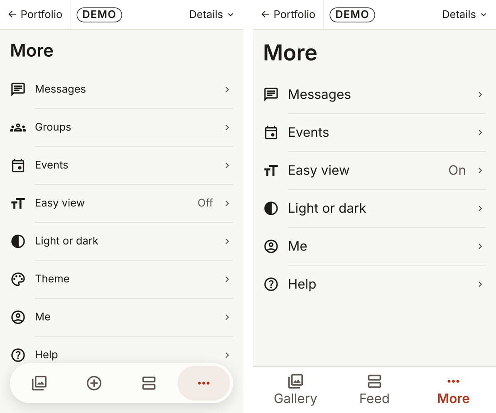
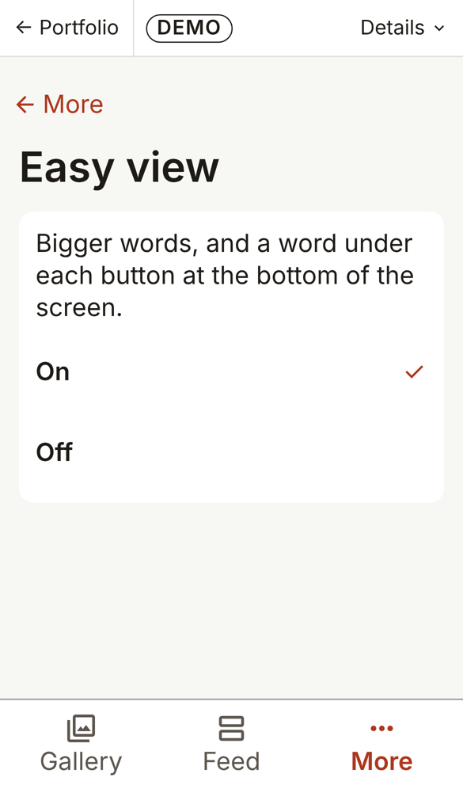

# Case study: Easy view, one switch for two kinds of family

**Part of:** [Hearth](CASE-STUDY.md), a private family photo app for split families and for grandparents who stay off social media. **Role:** founder and product manager, solo, with a team of Claude agents. **When:** Nov 17 to 20, 2026. **Try it:** in the [no-login demo](https://chaseholroyd.com/hearth/), open Details and pick "See the photos as Grandma Jo sees them".

## The problem

Hearth has two kinds of users on the same screens. Parents post every day and live in Instagram and Apple Photos. Grandparents, some on old Android phones in rural West Virginia, mostly look and heart. Hearth's first design rule served the grandparents: text 17 pt or larger, 48 pt tap targets, and a word under every icon, for everyone.

Then the app got a cleaner, Apple-style redesign, and the founder (also a parent and Hearth's first user) saw it on his own phone: "labels under tab icons should be off by default." The words that make the app safe for a great-grandparent made it look dated to the person who posts. A single look couldn't serve both.

## The call

One setting in More, called **Easy view**, with **On** and **Off** written out. It bundles the grandparent comforts: a word under each tab icon and bigger text. It replaced the old "Bigger text" switch, and a saved Bigger text choice carries over.

The important part is the default. **Easy view is On for invited grandparents and Off for parents** (DEC-66). Nobody is asked. A grandparent opens the app for the first time and every word is already there; a parent gets the cleaner bar of the apps they already use.

| Option | Why it lost |
|---|---|
| Words under every tab for everyone (the original rule) | Parents read it as dated; they post most, so they set the first impression |
| A separate "Tab words" switch next to "Bigger text" | Two switches to explain over the phone instead of one |
| Off for everyone, and tell grandparents to turn it on | Fails Hearth's goal "no help on old phones": the people who need it are the least able to find it |

## How it was checked

**Persona check before the build.** Hearth runs every product call past eight personas, one Green or Red row each, and CI fails a decision without one ([check](../product/decisions/2026-11-17-easy-view.md)). Seven were Green. One was Red: the **far-away inviter**, the parent setting Grandma up over the phone, whose tab bar has no words while Grandma's does. The answer was to keep both bars the same in every way except the words: same tabs, same order, same icons, and the words Grandma sees are the names a screen reader speaks on the parent's phone. The parent can also turn Easy view on in one step to see what Grandma sees.

**Off doesn't mean less accessible.** With Easy view Off, every tab still speaks its name to VoiceOver and TalkBack, keeps its 48 pt target, and no action becomes gesture-only. Easy view changes only the tab words and the text size (RD-79).

**Tests written first.** Each automated rule (RD-74 to RD-80) had a failing test before the code: the role default, the carry-over from Bigger text, the spoken names, tab words that must not clip at a 360 pt Android width, and a browser test that the demo switches between the two views. The last rule (RD-81) is a hands-on check on a real iPhone and Android phone.

## What it unlocked

Splitting the audience by one switch let each side go further without hurting the other.

- **The native glass bar for parents (DEC-70).** With Easy view Off on an iPhone, Hearth uses Apple's own tab bar, so iOS 26 gives parents the floating Liquid Glass capsule for free, and it shrinks as they scroll (DEC-75). With Easy view On, grandparents keep Hearth's fixed, solid bar with words: it never floats, blurs or shrinks. Hearth had dropped Apple's bar on Nov 5 because its glass overlapped Hearth's 17 pt tab words. Once only Easy view showed words, that problem belonged to grandparents' fixed bar alone, and parents could have the native one back.
- **The demo shows both (DEC-72).** Most people only see Hearth through the web demo, so the demo draws a lookalike of the glass bar for the parent and the fixed bar for Grandma Jo. Picking Grandma Jo's view is the quickest way to see the whole idea.

## Next: Share follows Easy view (in progress)

<!-- Fill in once the Share split ships: DEC number, PR, a screenshot pair of Share Off vs On. -->

Easy view is starting to change behavior, not just looks. Testing the new Share screen, the founder judged that being dropped straight into the photo picker would feel jarring to older users, who are better served by choosing the next step themselves. The plan is to split Share: with Easy view Off it opens straight to the photos, as parents expect; with Easy view On it opens the postcard first and the person taps "Add photos" themselves. This section will be finished once it ships.

## What I don't know yet

No real grandparent has used Easy view yet. The defaults rest on personas and on the founder's own family, not on measured results. The iPhone side (Apple's bar, the glass, the shrink on scroll) is built and tested in code but still waits on a check on a real iPhone. The first real test is the beta with about a dozen West Virginia grandparents, and the questions are simple: did anyone turn Easy view off, did any parent turn it on, and did anyone need help finding it.

## What I'd tell another PM

- **Default by role, not by asking.** The people who most need an accessibility setting are the least likely to find it. If you know who they are at sign-up, decide for them and keep the switch one tap away.
- **One plain switch beats a panel of options.** "Turn on Easy view" is one sentence on a phone call to a grandparent.
- **Name the persona who loses.** The only Red row produced the best rule in the design: both bars stay identical except for the words.

*Decisions: DEC-66, DEC-70, DEC-72, DEC-75 in [the decision log](../product/DECISION-LOG.md). Spec: [SPEC-REDESIGN.md](../product/SPEC-REDESIGN.md) section 1g.*
